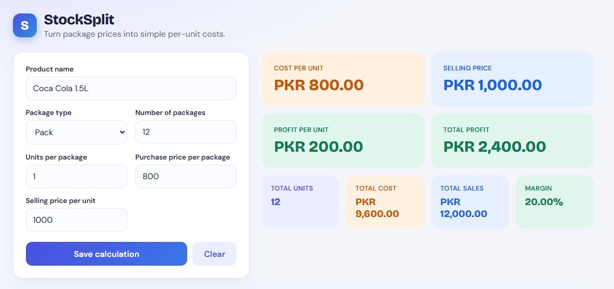

# StockSplit

Turn package prices into simple per-unit costs.

StockSplit is a small utility for shopkeepers and small businesses. Enter how many packages you bought, how many units are in each, and what you paid, and it instantly shows your true cost per unit, selling value, profit and margin. Calculations can be saved to a searchable history.

Repo: https://github.com/asimhashmi47/stock-split

## Screenshot



## Features

- Live calculator: total units, cost per unit, total cost, total sales, profit per unit, total profit and margin %
- Package types: Carton, Box, Pack, Dozen, Bundle or a custom name
- Colour-coded results: cost (orange), sales (blue), profit (green), loss (red)
- Saved history with search, view/recalculate and delete
- Client and server validation with friendly error messages
- Responsive layout for desktop, tablet and mobile

## Tech Stack

| Layer    | Technology                                             |
| -------- | ------------------------------------------------------ |
| Frontend | React, Vite, TypeScript, framer-motion                 |
| Backend  | ASP.NET Core Web API (.NET 10), Entity Framework Core  |
| Database | SQLite                                                 |
| Tests    | xUnit                                                  |

## Project Structure

```
StockSplit/
├── backend/
│   ├── StockSplit.Api/     # Controllers, Models, Data (DbContext), Services
│   └── StockSplit.Tests/   # xUnit tests for the calculation logic
└── frontend/
    └── src/                # components, api client, utils
```

## Getting Started

### Prerequisites

- [.NET SDK 10](https://dotnet.microsoft.com/download)
- [Node.js 22+](https://nodejs.org/)

### Run the backend

```bash
cd backend/StockSplit.Api
dotnet run --launch-profile http
```

The API runs at `http://localhost:5146`. The SQLite database (`stocksplit.db`) is created automatically on first start.

### Run the frontend

```bash
cd frontend
npm install
npm run dev
```

Open `http://localhost:5173`.

### Run the tests

```bash
cd backend
dotnet test
```

### Build for production

```bash
cd frontend
npm run build
```

## Configuration

| Setting                  | Where                                   | Default                   |
| ------------------------ | --------------------------------------- | ------------------------- |
| `VITE_API_URL`           | Frontend environment                    | `http://localhost:5146`   |
| `VITE_CURRENCY`          | Frontend environment                    | `PKR`                     |
| `ConnectionStrings:Default` | `backend/StockSplit.Api/appsettings.json` | `Data Source=stocksplit.db` |
| `AllowedOrigins`         | `backend/StockSplit.Api/appsettings.json` | `http://localhost:5173`   |

## API

| Method | Endpoint                | Description                      |
| ------ | ----------------------- | -------------------------------- |
| GET    | `/api/calculations`     | List saved calculations          |
| GET    | `/api/calculations/{id}`| Get one calculation              |
| POST   | `/api/calculations`     | Calculate and save               |
| DELETE | `/api/calculations/{id}`| Delete a calculation             |

Example request body for `POST`:

```json
{
  "productName": "Coca Cola 1.5L",
  "packageType": "Carton",
  "packageCount": 5,
  "unitsPerPackage": 24,
  "purchasePricePerPackage": 1800,
  "sellingPricePerUnit": 90
}
```

The server calculates the derived values, so the response for the example above includes:

| Field               | Value   |
| ------------------- | ------- |
| `totalUnits`        | 120     |
| `totalPurchaseCost` | 9000    |
| `costPerUnit`       | 75      |
| `totalSalesValue`   | 10800   |
| `profitPerUnit`     | 15      |
| `totalProfit`       | 1800    |
| `profitMargin`      | 16.67   |

## Calculation Rules

- Total units = packages × units per package
- Total cost = packages × purchase price per package
- Cost per unit = total cost ÷ total units
- Total sales = total units × selling price per unit
- Profit per unit = selling price − cost per unit
- Total profit = total sales − total cost
- Margin % = total profit ÷ total sales × 100 (0 when sales are 0)

## Scope

StockSplit is intentionally a small, focused calculator. It has no authentication, inventory, accounting or multi-user features.
